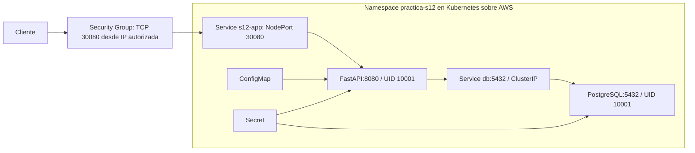

# S12 Cloud Lab — Kubernetes, seguridad y troubleshooting

Aplicación pequeña para S12 / AP9. FastAPI sirve un panel web y consulta PostgreSQL
para comprobar conectividad real. Incluye tres fallas controladas y sus correcciones.
No depende de BerryControl.

## Arquitectura



| Ruta | Función |
| --- | --- |
| `/` | Panel web con estado de la base de datos y UID real del proceso |
| `/api/status` | JSON con hostname, UID/GID y resultado de una consulta SQL |
| `/health/live` | HTTP 200 si el proceso HTTP está activo |
| `/health/ready` | HTTP 200 si PostgreSQL responde; HTTP 503 si falla |
| `/docs` | Documentación interactiva de la API |

## 1. Prueba local (PowerShell)

Requisitos: Git y Docker Desktop iniciado en modo Linux.
Si ya tienes la carpeta clonada, entra directamente en ella.

```powershell
git clone https://github.com/LuciaSanchezMiranda/OAS_TroubleshootingS12.git
cd OAS_TroubleshootingS12
docker compose up -d --build
docker compose ps
curl.exe -i http://localhost:8080/health/ready
curl.exe -i http://localhost:8080/api/status
docker compose exec app id
docker compose exec db id
```

Abrir [http://localhost:8080](http://localhost:8080). Debe mostrar base de datos
conectada y UID 10001. Las imágenes se descargan en la primera ejecución.
Si el puerto 8080 está ocupado, cambiar únicamente el primer 8080 de `ports` en Compose.

**CAPTURA LOCAL OPCIONAL:** panel completo y terminal con `id` y HTTP 200.
Sirve para ensayar; las evidencias obligatorias del informe se obtienen en AWS.

Para detener esta prueba: `docker compose down`. La base de datos es desechable.

## 2. Publicar imagen para AWS

Cuenta de Docker Hub: `luci4sanchez2007`. No publicar credenciales.

```powershell
docker login
docker build --platform linux/amd64 -t luci4sanchez2007/s12-cloud-lab:1.0.0 .
docker push luci4sanchez2007/s12-cloud-lab:1.0.0
```

`k8s/03-app-deployment.yaml` ya usa
`luci4sanchez2007/s12-cloud-lab:1.0.0`. El repositorio de imagen debe ser público o se
deberá configurar un imagePullSecret. Esta compilación está dirigida a nodos AWS x86_64.

## 3. Preparar Kubernetes sobre AWS

Usar el clúster del curso o preparar uno con los permisos disponibles en AWS Academy.
La creación de la infraestructura depende del tipo de cuenta; no ejecutar comandos
de aprovisionamiento hasta verificar permisos, presupuesto y región.

Esta versión usa **NodePort**, una de las dos opciones autorizadas por la guía:

- El nodo Linux debe tener IP pública y ruta de acceso desde Internet.
- Configurar su Security Group con TCP **30080** desde **tu IP pública /32**.
- Para una revisión externa, autorizar también la IP del evaluador o conectarse
  por el acceso acordado con el profesor.
- No abrir PostgreSQL/5432 a Internet ni exponer el API de Kubernetes a todo origen.
- En nodos privados usar LoadBalancer con el controlador AWS apropiado; NodePort
  por sí solo no crea una IP pública ni un balanceador.
- El acceso HTTP del laboratorio no proporciona TLS. La protección de acceso
  se realiza con el SG; para cifrado en tránsito se requiere configurar HTTPS.

Antes de aplicar nada, confirmar que kubectl apunta al clúster **de AWS**:

```powershell
kubectl config current-context
kubectl get nodes -o wide
```

**CAPTURA 01 — AWS:** nodos Ready y contexto. Complementar con la consola AWS del
nodo/clúster y regla del SG. `docker-desktop` es local y no demuestra AWS.

## 4. Desplegar el estado correcto

Desde la raíz del repositorio:

```powershell
kubectl apply -f k8s/00-namespace.yaml
kubectl apply -f k8s/
kubectl rollout status deployment/s12-db -n practica-s12 --timeout=180s
kubectl rollout status deployment/s12-app -n practica-s12 --timeout=180s
kubectl get pods,svc -n practica-s12
```

Esperar ambos Pods `1/1 Running`. Si hay ImagePullBackOff, revisar nombre, etiqueta
y publicación de la imagen. El primer arranque puede esperar a PostgreSQL.

Probar `http://IP_PUBLICA_NODO:30080` y `/api/status` desde tu equipo.
Si no responde, revisar SG, IP, ruta pública, puertos del Service y Pods Ready.

## 5. Escenario A: mala configuración

En la instancia Ubuntu/K3s se pueden usar `bash scripts/scenario.sh A` y
`bash scripts/scenario.sh A --fix` (igual con B/C), y `bash scripts/diagnose.sh`.
Los ejemplos PowerShell de abajo se ejecutan desde Windows con acceso al clúster.
Para los comandos manuales dentro de Ubuntu utilizar `sudo k3s kubectl` en lugar
de `kubectl`; las variables `$appPod` y las tuberías PowerShell requieren su
equivalente Bash. No ejecutar scripts PowerShell directamente en Bash.

No aplicar los tres escenarios al mismo tiempo. Completar antes/después de cada uno.
Los scripts de PowerShell pueden ejecutarse así si tu política local lo requiere:
`powershell -ExecutionPolicy Bypass -File scripts/scenario.ps1 -Scenario A`.
Esto solo establece la política de ese proceso, no cambia la del sistema.

```powershell
.\scripts\scenario.ps1 -Scenario A
kubectl get pods -n practica-s12 -w
```

Esperar que el **Pod nuevo** muestre Error/CrashLoopBackOff; salir del seguimiento
con Ctrl+C. En un rolling update el Pod anterior puede seguir Running.

```powershell
$appPod = kubectl get pods -n practica-s12 -l app=s12-app --sort-by=.metadata.creationTimestamp -o jsonpath='{.items[-1].metadata.name}'
kubectl logs $appPod -n practica-s12
kubectl logs $appPod -n practica-s12 --previous
kubectl describe pod $appPod -n practica-s12
kubectl get configmap s12-config -n practica-s12 -o yaml
```

**CAPTURA 02 — A ANTES:** Pods con el fallo y log `CONFIG_ERROR` por `APP_ENV`.
Es un valor inválido en una clave existente. Una referencia a una clave inexistente
podría producir CreateContainerConfigError en vez de CrashLoopBackOff.

```powershell
.\scripts\scenario.ps1 -Scenario A -Fix
kubectl get pods -n practica-s12
```

**CAPTURA 03 — A DESPUÉS:** Pods `1/1 Running`. Si aparece un Pod antiguo en
`Terminating`, esperar unos segundos y repetir `kubectl get pods` antes de capturar.
Corrección: `APP_ENV=lab`
y recreación del Pod, porque las variables de `envFrom` no cambian en caliente.

## 6. Escenario B: puerto interno incorrecto

```powershell
.\scripts\scenario.ps1 -Scenario B
kubectl get pods -n practica-s12 -w
```

Esperar 10–30 segundos para ver la app `0/1`; Ctrl+C para continuar.
El proceso puede seguir Running: readiness fallida no significa que esté detenido.

```powershell
kubectl get service db -n practica-s12 -o yaml
kubectl get endpointslices -n practica-s12 -l kubernetes.io/service-name=db -o wide
$appPod = kubectl get pods -n practica-s12 -l app=s12-app --sort-by=.metadata.creationTimestamp -o jsonpath='{.items[-1].metadata.name}'
Get-Content .\scripts\check-db.py -Raw | kubectl exec -i $appPod -n practica-s12 -- python -
kubectl logs $appPod -n practica-s12 --tail=20
```

**CAPTURA 04 — B ANTES:** DNS resuelve pero TCP falla; YAML muestra
`port: 5432` y `targetPort: 5433`. La base de datos realmente escucha en 5432.

```powershell
.\scripts\scenario.ps1 -Scenario B -Fix
Get-Content .\scripts\check-db.py -Raw | kubectl exec -i $appPod -n practica-s12 -- python -
kubectl get pods -n practica-s12
```

**CAPTURA 05 — B DESPUÉS:** DNS, TCP y `SELECT 1 -> 1`, con app `1/1`.

## 7. Escenario C: sondas con endpoints incorrectos

```powershell
.\scripts\scenario.ps1 -Scenario C
kubectl get pods -n practica-s12 -w
```

Esperar al menos un reinicio del Pod nuevo (aprox. 20–60 segundos), Ctrl+C.

```powershell
$appPod = kubectl get pods -n practica-s12 -l app=s12-app --sort-by=.metadata.creationTimestamp -o jsonpath='{.items[-1].metadata.name}'
kubectl describe pod $appPod -n practica-s12
kubectl get pods -n practica-s12
```

**CAPTURA 06 — C ANTES:** eventos `Liveness probe failed` / `Readiness probe failed`
con HTTP 404 y contador RESTARTS mayor a cero.

```powershell
.\scripts\scenario.ps1 -Scenario C -Fix
kubectl get pods -n practica-s12
kubectl get deployment s12-app -n practica-s12 -o yaml
```

**CAPTURA 07 — C DESPUÉS:** app `1/1`, rutas `/health/live` y `/health/ready`.
Probar HTTP 200 de las dos rutas usando la URL pública.

## 8. Seguridad y prueba final

```powershell
kubectl exec deployment/s12-app -n practica-s12 -- id
kubectl exec deployment/s12-db -n practica-s12 -- id
kubectl exec deployment/s12-app -n practica-s12 -- touch /app/no-debe-crearse
kubectl get pods -n practica-s12
curl.exe -i http://IP_PUBLICA_NODO:30080/health/live
curl.exe -i http://IP_PUBLICA_NODO:30080/health/ready
curl.exe -i http://IP_PUBLICA_NODO:30080/api/status
```

**CAPTURA 08 — SEGURIDAD:** UID 10001 y escritura rechazada por filesystem de solo
lectura. El fallo de `touch` es el resultado esperado. Mostrar también securityContext.

**CAPTURA 09 — SERVICIO:** panel web a través de la IP pública y HTTP 200 en JSON,
con base de datos conectada. Incluir URL y estado de Pods en el informe.

Las nueve capturas se agrupan en las cuatro evidencias pedidas: troubleshooting
antes/después, contexto de seguridad, logs/eventos y servicio funcionando.
No mostrar el contenido de Secrets reales en capturas.

## Archivos y entrega

```text
app/                         Backend y panel web
k8s/00-namespace.yaml         Aislamiento y Pod Security restricted
k8s/01-security-configmap.yaml
k8s/02-db-secret.yaml         Credenciales Base64 desechables
k8s/03-app-deployment.yaml    Seguridad y sondas de la aplicación
k8s/04-app-service.yaml       NodePort
k8s/05-db-deployment.yaml     PostgreSQL non-root y volúmenes escribibles
k8s/06-db-service.yaml        Acceso interno a PostgreSQL
scenarios/                   Parches defectuosos y corregidos, separados de k8s/
scripts/scenario.ps1          Aplicar o corregir una falla
scripts/diagnose.ps1          Logs, eventos y configuración de red
scripts/check-db.py           Diagnóstico DNS, TCP y SQL desde el Pod
docs/troubleshooting-log.md   Plantilla de informe para completar con evidencias
docs/video-script.md          Guion de 3–5 minutos
```

Completar `docs/troubleshooting-log.md` con lo observado, copiarlo al Google Doc e
insertar las capturas. Añadir enlaces al repositorio público y al video. Configurar
el documento y el video para que el profesor pueda abrirlos.

## Alcance de seguridad y almacenamiento

Ambos procesos usan UID/GID 10001, raíz de solo lectura, seccomp y capabilities
eliminadas. PostgreSQL necesita escritura en datos, socket y temporales; solamente
esos directorios se montan como volúmenes escribibles.

El Secret contiene un usuario y contraseña **públicos de demostración**. No
reutilizarlos. Base64 no cifra. Una aplicación real debe gestionar secretos fuera
de Git y usar credenciales exclusivas. La base usa `emptyDir` (Compose usa tmpfs):
se pierden los datos al reemplazar el Pod/contenedor. No es almacenamiento productivo.

Al acabar las evidencias y la revisión del profesor, retirar solamente los recursos
de este laboratorio. Borrar el namespace elimina sus cargas y datos; eliminar además
infraestructura AWS dedicada que siga generando cobros, según el tipo de cuenta.

Referencias: [SecurityContext](https://kubernetes.io/docs/tasks/configure-pod-container/security-context/),
[Secrets](https://kubernetes.io/docs/concepts/configuration/secret/),
[sondas](https://kubernetes.io/docs/concepts/workloads/pods/probes/).
